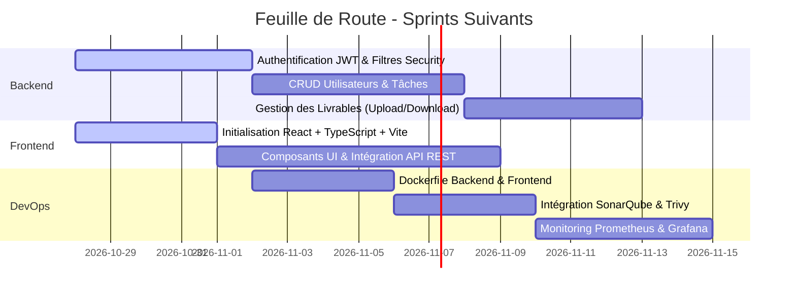

# État d'Avancement du Projet — Plateforme PFE

**Projet** : Plateforme de Gestion des Projets PFE (Avec CI/CD, DevSecOps et Monitoring)  
**Méthodologie** : Scrum Agile (Sprints)  
**Équipe (4 étudiants)** : Yassine El Ansari, Safia, Salma, Mohamed (Simo)  
**Date de dernière mise à jour** : 27 Octobre 2026  
**Branche actuelle de référence** : `dev-yassine` / `main`

---

## 📊 1. Vue Synthétique d'Avancement

| Domaine / Composant | Statut | Progression | Responsable(s) / Branche |
|---|:---:|:---:|---|
| **Socle & Gouvernance Git** | ✅ Terminé | 100% | Équipe complète (`main`, branches `dev-*`) |
| **Backend Spring Boot 3 & Java 21** | ✅ Terminé (Sprint 1) | 100% | Yassine (`dev-yassine`) |
| **Base de Données & Migrations Flyway** | ✅ Terminé | 100% | Yassine (`dev-yassine`) |
| **API REST & Documentation OpenAPI** | ✅ Terminé (Socle) | 100% | Yassine (`dev-yassine`) |
| **Tests Automatisés Backend** | ✅ Opérationnels | 100% (17/17 tests réussis) | Yassine (`dev-yassine`) |
| **Pipeline CI (GitHub Actions)** | ✅ Opérationnelle | 100% | Yassine (`dev-yassine`) |
| **Frontend React + TypeScript** | 🟡 En cours d'initialisation | 10% | Équipe Frontend (`dev-safia`, `dev-salma`, `dev-simo`) |
| **Authentification Avancée (JWT)** | ⏳ À venir (Sprint 2) | 0% | À planifier |
| **Conteneurisation (Docker & Compose)** | ⏳ À venir | 0% | DevOps |
| **DevSecOps (SonarQube, Trivy, ZAP)** | ⏳ À venir | 15% (Workflow sécurité initialisé) | DevOps |
| **Monitoring (Prometheus, Grafana, Loki)** | ⏳ À venir | 10% (Actuator endpoints prêts) | DevOps |

---

## 🚀 2. Détail des Réalisations (Ce qui est fait)

### A. Socle Backend Spring Boot (`backend/`)
- [x] Initialisation propre avec **Spring Boot 3.3.5** et compatibilité **Java 21 / JDK 27**.
- [x] Intégration du **Maven Wrapper** officiel (`mvnw`, `mvnw.cmd`, `.mvn/`).
- [x] Architecture professionnelle en couches :
  - `controller` : Exposition des endpoints HTTP REST.
  - `service` / `service.impl` : Logique métier découplée et transactions managées.
  - `repository` : Accès aux données Spring Data JPA avec requêtes paginées.
  - `entity` : Modèles JPA avec cycle de vie `@PrePersist` / `@PreUpdate`.
  - `dto` (request & response) : Objets de transfert isolés des entités.
  - `mapper` : Transformation Entity ↔ DTO dédiée (`ProjectMapper`).
  - `security` : Sécurité Spring Security stateless avec encodeur de mots de passe **BCrypt**.
  - `exception` : Gestionnaire unifié `@RestControllerAdvice` (codes HTTP 400, 401, 403, 404, 409, 500).
  - `config` : Documentation interactive OpenAPI / Swagger UI.

### B. Base de Données Relationnelle MySQL & Flyway
- [x] Création et paramétrage de la base de données `pfe_management` et de son utilisateur dédié `pfe_user`.
- [x] Externalisation des secrets via variables d'environnement (`.env.example` et `application.yml`).
- [x] Configuration Hibernate en `ddl-auto: validate` pour proscrire toute destruction non contrôlée.
- [x] Script de migration versionné **`V1__initial_schema.sql`** appliqué avec succès :
  - Table `users` (avec rôle, contrainte d'unicité email et index).
  - Table `projects` (avec statut enum et index).
  - Table `project_members` (avec clé étrangère et contrainte d'unicité `(project_id, user_id)`).
  - Table `tasks` (avec priorités, statuts et assignation).
  - Table `deliverables` (avec chemins de fichiers et horodatages).

### C. Première API REST Métier (`/api/v1/projects`)
- [x] `GET /api/v1/projects` : Consultation publique avec pagination configurable (`page`, `size`, `sortBy`, `direction`) et filtrage par statut (`ProjectStatus`).
- [x] `GET /api/v1/projects/{id}` : Consultation détaillée d'un projet par son identifiant.
- [x] `POST /api/v1/projects` : Création sécurisée avec contrôle d'accès (HTTP 401 pour anonymes) et validation Jakarta (`@Valid`).
- [x] `PUT /api/v1/projects/{id}` : Mise à jour complète avec vérification des conflits de titres.
- [x] `DELETE /api/v1/projects/{id}` : Suppression d'un projet existant.
- [x] Swagger UI actif et explorable sur [http://localhost:8080/swagger-ui.html](http://localhost:8080/swagger-ui.html).

### D. Qualité & Tests Automatisés
- [x] **17 tests automatisés validés à 100%** (exécutables via `.\mvnw.cmd test` ou `./mvnw test`) :
  - Test de chargement du contexte Spring (`PfeManagementApplicationTests`).
  - Tests unitaires de validation des contraintes DTO (`ProjectDtoValidationTest`).
  - Tests unitaires de la logique métier avec Mockito (`ProjectServiceImplTest`).
  - Tests d'intégration des routes HTTP et sécurité avec MockMvc (`ProjectControllerTest`).
- [x] Isolation complète grâce au profil de test `application-test.yml` s'appuyant sur la base en mémoire H2 (aucune altération de la base MySQL locale).

### E. Intégration Continue (GitHub Actions)
- [x] Création du workflow unifié [`.github/workflows/ci.yml`](file:///.github/workflows/ci.yml) :
  - **Job Backend** : Setup JDK 21 (Temurin), cache Maven, compilation, exécution des tests et archivage des rapports Surefire + JAR.
  - **Job Frontend** : Prêt pour Node 20.x, détection automatique, `npm ci`, test et build.
  - **Job CI Gate** : Porte de validation unique pour les branch protections rules.
- [x] Documentation complète intégrée dans le [README.md](file:///README.md).

---

## 🎯 3. Prochaines Étapes Prioritaires (Backlog Scrum)



### Sprint suivant (Sprint 2) :
1. **Frontend** :
   - Initialiser l'application React + TypeScript (Vite/Next.js) dans `frontend/`.
   - Mettre en place Axios / Fetch client configuré avec `baseURL: http://localhost:8080/api/v1`.
   - Créer la vue d'accueil et le tableau de bord de consultation des projets.
2. **Backend & Sécurité** :
   - Implémenter l'authentification JWT complète (`/api/v1/auth/login`, `/api/v1/auth/register`).
   - Ajouter le filtre `JwtAuthenticationFilter` dans la chaîne Spring Security.
   - Restreindre les actions selon les rôles (`ADMIN`, `SUPERVISOR`, `STUDENT`).
3. **DevOps** :
   - Créer les `Dockerfile` multi-stage optimisés pour le frontend et le backend.
   - Configurer `docker-compose.yml` pour le lancement local en 1 commande (Frontend + Backend + MySQL).

---

## 📌 4. Comment Tester l'État Actuel Localement ?

```powershell
# 1. Vérifier que MySQL est démarré et que la base existe
mysql -u pfe_user -ppfe_password -e "USE pfe_management; SHOW TABLES;"

# 2. Lancer les tests automatisés du backend
cd backend
.\mvnw.cmd test

# 3. Démarrer le backend Spring Boot
.\mvnw.cmd spring-boot:run

# 4. Accéder à l'interface Swagger UI :
# http://localhost:8080/swagger-ui.html
```
