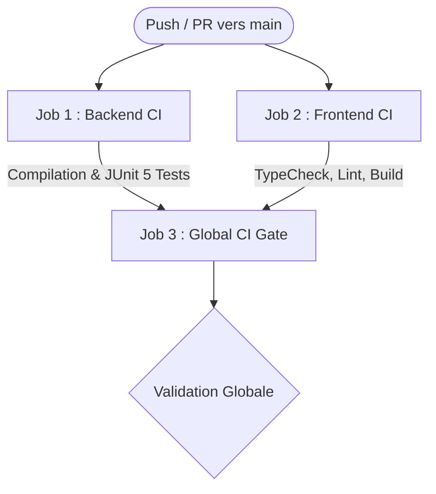

[](https://github.com/elansari111/PFE-Management-Platform/actions/workflows/ci.yml)
[](https://github.com/elansari111/PFE-Management-Platform/actions/workflows/security.yml)

Plateforme collaborative et sécurisée dédiée à la gestion complète des Projets de Fin d'Études (PFE) : soumission des sujets, affectation, suivi des livrables et soutenances.

---

## 👥 Équipe de Développement
Projet académique réalisé par une équipe de 4 développeurs :
- **Yassine El Ansari** (Branche : `dev-yassine`)
- **Safia** (Branche : `dev-safia`)
- **Salma** (Branche : `dev-salma`)
- **Mohamed (Simo)** (Branche : `dev-simo`)

---

## ⚙️ Intégration Continue Globale (CI/CD)

Le projet dispose d'une pipeline d'intégration continue unifiée sous GitHub Actions :
- **Fichier de workflow** : `.github/workflows/ci.yml`
- **Rôle de la CI** : Valider automatiquement et en parallèle la conformité du **Backend (Spring Boot)** et du **Frontend (React)** sur chaque proposition de code.
- **Événements déclencheurs** :
  - `push` sur la branche `main`.
  - `pull_request` vers `main`.
  - `workflow_dispatch` (déclenchement manuel via GitHub).

### Architecture des Jobs parallèles :



1. **Job 1 : Backend CI (`backend-ci`)**
   - Environnement : `ubuntu-latest`, JDK 21 (Temurin) avec cache Maven.
   - Exécution : `./mvnw -B clean verify`.
   - Tests JUnit 5 avec base isolée H2 (aucun conteneur MySQL externe nécessaire pendant les tests unitaires).
   - Publication des rapports Surefire (`backend-surefire-reports`) et de l'archive JAR (`backend-jar`).

2. **Job 2 : Frontend CI (`frontend-ci`)**
   - Environnement : `ubuntu-latest`, Node.js LTS (20.x) avec cache `npm`.
   - Détection automatique de l'état d'avancement du dossier `frontend/` (compatible avec les branches des membres pendant l'initialisation React).
   - Dès initialisation : installation dépendances (`npm ci`), vérification des types TypeScript (`tsc --noEmit`), linter ESLint, exécution des tests et build de production.
   - Publication des livrables de production (`frontend-build`).

3. **Job 3 : Global CI Gate (`ci-status-check`)**
   - Sert de verrou global unique pour les **règles de protection de branche GitHub** (`Branch protection rules` sur `main`).
   - Bloque la fusion si le backend ou le frontend présente une anomalie.

---

### Exécution locale des vérifications :

```powershell
# Vérification Backend :
cd backend
.\mvnw.cmd -B clean verify

# Vérification Frontend (dès package.json présent) :
cd frontend
npm test
npm run build
```

---


---

## 🔐 Sécurité & Authentification (JWT & RBAC)

La plateforme intègre une sécurité complète basée sur des tokens JWT signés (HMAC SHA-256) :
- **Inscription (POST /api/v1/auth/register)** : Inscription publique sécurisée, rôle STUDENT attribué obligatoirement par défaut pour prévenir toute escalade de privilèges.
- **Connexion (POST /api/v1/auth/login)** : Authentification par email/mot de passe avec hashage BCrypt et génération d'un Bearer token JWT stateless.
- **Profil connecté (GET /api/v1/auth/me)** : Récupération des informations de profil via le header Authorization: Bearer <token>.
- **Contrôle d'accès par rôle (RBAC)** : Prise en charge des rôles ADMIN, SUPERVISOR, STUDENT.
- **Zéro fuite d'identifiants** : Les mots de passe et hashs ne sont jamais exposés dans les réponses API.

---

## 📡 Documentation API (Swagger / OpenAPI 3)

L'API REST est entièrement documentée et explorable de manière interactive :
- **Swagger UI** : [http://localhost:8080/swagger-ui.html](http://localhost:8080/swagger-ui.html)
- **Spécification OpenAPI v3 (JSON)** : [http://localhost:8080/v3/api-docs](http://localhost:8080/v3/api-docs)
- **Actuator Health / Monitoring** : [http://localhost:8080/actuator/health](http://localhost:8080/actuator/health)

Endpoints principaux disponibles :
| Domaine | Méthode | URL | Description | Accès |
|---|:---:|---|---|:---:|
| **Auth** | POST | /api/v1/auth/register | Inscription d'un compte étudiant | Public |
| **Auth** | POST | /api/v1/auth/login | Connexion et obtention du token JWT | Public |
| **Auth** | GET | /api/v1/auth/me | Consultation de son profil utilisateur | Authentifié (JWT) |
| **Projects** | GET | /api/v1/projects | Liste paginée avec filtres et tris | Public |
| **Projects** | GET | /api/v1/projects/{id} | Détail d'un projet PFE | Public |
| **Projects** | POST | /api/v1/projects | Création d'un nouveau projet PFE | Authentifié (JWT) |
| **Projects** | PUT | /api/v1/projects/{id} | Mise à jour complète d'un projet | Authentifié (JWT) |
| **Projects** | DELETE | /api/v1/projects/{id} | Suppression d'un projet | Authentifié (JWT) |

## 📁 Structure du Projet

```text
PFE-Management-Platform/
├── frontend/             # Application cliente (UI / Dashboard)
├── backend/              # API serveur et logique métier
├── .github/
│   └── workflows/        # Pipelines GitHub Actions (CI & Sécurité)
├── .gitignore            # Fichiers et dossiers ignorés par Git
├── .env.example          # Modèle de variables d'environnement
└── README.md             # Documentation du projet
```

---

## 🔄 Workflow Git Collaboratif

1. **Branches principales** :
   - `main` : Version stable et prête pour la production.
   - `develop` : Branche commune d'intégration.
2. **Branches personnelles** :
   - `dev-yassine`, `dev-safia`, `dev-salma`, `dev-simo`.
3. **Cycle de développement** :
   - Chaque développeur travaille sur sa branche personnelle.
   - Synchronisation régulière avec `develop` :
     ```bash
     git checkout develop
     git pull origin develop
     git checkout dev-votre-nom
     git merge develop
     ```
   - Création d'une **Pull Request vers `develop`**.
   - Exécution automatique des vérifications CI/CD.
   - Revue et validation par un autre membre de l'équipe avant merge.
   - `develop` est ensuite fusionnée dans `main` pour les versions stables.

---

## 🚀 Démarrage Rapide

### 1. Cloner le dépôt
```bash
git clone https://github.com/elansari111/PFE-Management-Platform.git
cd PFE-Management-Platform
```

### 2. Configurer les variables d'environnement
```bash
# Windows (PowerShell) :
Copy-Item .env.example .env

# Linux / macOS / Git Bash :
cp .env.example .env
```

> **Important** : Ne jamais commiter le fichier `.env` résultant.
